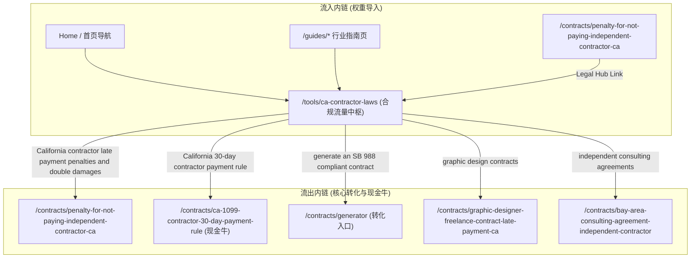

# P0-3 方案规划：/tools/ca-contractor-laws 内容纵深增强

> **页面目标**：`https://indielegalterms.com/tools/ca-contractor-laws`  
> **当前状态**：全站曝光最大（333 曝光、排名 15.5），定位为全站合规中枢与权重枢纽。  
> **当前瓶颈**：首屏交互工具（`ContractorAuditTool`、`MisclassificationCostCalculator`）体验优良，但下半部分文本的法律纵深不足（对加州最新判例、细分职业豁免规则、EDD 审计红线展开不深），且缺少工具类结构化数据声明。  
> **核心目标**：将页面升级为加州劳工分类与付款合规的权威枢纽，扩展法律深度内容，补充结构化数据，打通流向重点现金牛与转化页的高权重内链，将核心大词稳步推入 Google 首页前 10。

---

## 零、执行前 5 个明确点确认

1. **纯静态 Server Component 约束**：新建组件 `components/tools/CaContractorLawLegalDepth.tsx` 必须为纯静态 Server Component，严禁使用任何客户端交互钩子（如 `useState`、`useEffect`、客户端 Tab 等）。若需折叠一律使用 `<details>` 原生 HTML 标签，保证 100% 服务端直出。
2. **FAQPage Schema 1:1 完全对齐**：`FAQPage` Schema 从现有遗留的 3 条同步扩充至 5 条，与正文呈现的 5 条 FAQ 逐字一一对应，杜绝“正文 5 条、Schema 3 条”的不一致。
3. **Penalty 页反向链接闭环**：在 `/contracts/penalty-for-not-paying-independent-contractor-ca`（`components/contracts/PenaltyGuideDeepContent.tsx`）的合规导航区直出指向 `/tools/ca-contractor-laws` 的 `<Link>`，精确锚文本为 `California Contractor Laws Compliance Checker`。
4. **H2 层级与现有区块关系（替换整合而非堆砌）**：新组件系统性**替换（Replace）**原有的浅层 `The legal standard` 与泛化的 `How to Avoid AB5 Penalties in California` 文本，将四大核心深度模块与原有的支付合规要点无缝融合成统一的深度指南，绝不允许出现重复 H2 或内容断层。
5. **Cal. Lab. Code § 226.8 严格法定措辞**：不使用口语化“恶意模式”，严格使用法定表述：“pattern or practice（模式性或惯常性违规）可达 $25,000”。


---

## 一、承载结构分析与拟改文件清单

### 1. 现有页面区块诊断 (`app/tools/ca-contractor-laws/page.tsx`)
1. **Hero + 交互工具区**：
   - 顶部 Badge (`Updated for California AB5 & SB 988 — 2026`) + H1 (`California ABC Test & Borello Test Checker: AB5 Independent Contractor Compliance Tool`)；
   - 交互组件 1：`<ContractorAuditTool />`（2 分钟 AB5/Borello 分类风险测试）；
   - 交互组件 2：`<MisclassificationCostCalculator />`（1099 vs W-2 成本与误分类风险计算器）；
   - 交叉引导卡片：引导至 `/tools/irs-20-point-checklist` 与 `/tools/ca-demand-letter-template`。
2. **下半部分法律文本区（目前不足 500 词，内容偏薄）**：
   - `The legal standard`: `ABC Test vs. Borello Test: Which Applies to Your California Contractors?`（简短介绍三项条件与 6 个豁免条件）；
   - `Payment compliance`: `How to Avoid AB5 Penalties in California` + `California Independent Contractor Payment Laws & SB 988`（包含已在 PR-02 注入的指向 penalty 页的内链）；
3. **FAQ 区块**：
   - 5 条折叠问答（`FAQS`），服务端同时挂载了 3 条简版问答的 `FAQPage` JSON-LD（`FAQS_PLAIN`）；
4. **相关工具与跨州枢纽**：
   - 3 个工具卡片（合同生成器、催款函、罚金计算器）+ 指向 `/compliance` 的跨州 banner；
5. **底部 CTA**：
   - 锚点跳回 `#top` 重新运行审核。

### 2. 现有 TDK 与 Schema
- **Title**: `California ABC Test & Borello Test: Free Compliance Checker (2026)`
- **Meta Description**: `Audit your 1099 compliance instantly with our free California Independent Contractor Law tool. Test against AB5 ABC test, Borello test, and SB 988 rules for 2026 — plus a 1099 vs. W-2 true cost calculator that shows misclassification penalty exposure.`
- **Canonical**: `https://indielegalterms.com/tools/ca-contractor-laws`（自指规范）
- **Schema**: 现有仅包含 `FAQPage` JSON-LD，缺失能够表明页面具备交互式合规检测能力的软件类结构化数据。

### 3. 代码架构选择：页面内服务端直出 vs 新建组件
- **架构考量**：
  - 该页面为独立静态路由（`app/tools/ca-contractor-laws/page.tsx`），采用服务端静态生成（SSG）；
  - 首屏两个交互工具已封装为客户端组件；
  - 为防止 `page.tsx` 单个文件过度膨胀（目前已达 522 行，若直接堆砌 1,500+ 词的法律深度文本将超过 1,000 行），最佳技术方案为：
    - **新建服务端组件 `components/tools/CaContractorLawLegalDepth.tsx`**：承载加州劳工法 § 2778 豁免细则、ABC vs Borello 对比矩阵、EDD 审计合规红线及权威条文；
    - **在 `app/tools/ca-contractor-laws/page.tsx` 中直接引入并静态渲染**：完全保持 Server Component 属性，HTML 100% 服务端直出，保证 Googlebot 抓取无延迟。

### 4. 拟改动文件清单
| 文件路径 | 改动性质 | 改动说明 |
| :--- | :---: | :--- |
| `components/tools/CaContractorLawLegalDepth.tsx` | 新建组件 | 承载加州劳工法 § 2778 豁免细则、ABC vs Borello 执法差异对比矩阵、EDD 审计合规红线与法律来源 |
| `app/tools/ca-contractor-laws/page.tsx` | 页面模板 | 引入深度组件、注入 `WebApplication` Schema 复合标记、在 30-Day 规则处补齐指向 `/contracts/ca-1099-contractor-30-day-payment-rule` 的直出内链 |

---

## 二、H2/H3 详细大纲规划（不写正文）

### 模块 1：加州劳工法 § 2778 专业服务豁免深度拆解
- **层级结构**：
  - `H2: California Labor Code § 2778: Professional Services Exemption Explained`
    - `H3: Qualifying Creative & Consulting Occupations`
    - `H3: The 6 Mandatory Statutory Factors Under Labor Code § 2778(a)`
    - `H3: Legal Effect: Transitioning from ABC Test to Borello Test`
- **预估字数**：450 ~ 550 词
- **覆盖要点**：
  - 明确指出加州并非对所有自由职业者一刀切采用 ABC 测试。对于符合加州劳工法典第 2778 条（Labor Code § 2778）的特定专业服务角色（如平面设计师、自由文案、市场营销创意人员、摄影师/摄像师、独立顾问等），雇主可以通过证明满足全部 6 项法定前置要求，将分类判定标准由极为严苛的 ABC 测试转为较为灵活的 Borello 测试；
  - 逐一拆解 6 项法定前置条件：① 独立于雇主的营业场所（包含合规 Home Office）；② 具备营业执照或地方税务登记；③ 具有自主协商定价权；④ 自主决定工作时间（除交付截止日与合理联络时间外）；⑤ 习惯性向其他客户提供同类服务；⑥ 在履行服务中经常性行使自由裁量权与独立判断；
  - 强调界限：即使符合 § 2778 豁免转入 Borello 标准，也**仅影响分类属性，绝不免除 SB 988 的付款合规义务**（$250+ 书面合同与 30 天付款期限同样刚性适用）。

---

### 模块 2：ABC Test vs. Borello Test 对比与执法差异
- **层级结构**：
  - `H2: ABC Test vs. Borello Test: Legal Standard Comparison`
    - `H3: The Three Rigid Prongs of the California ABC Test (Labor Code § 2775)`
    - `H3: The Borello Common-Law Right of Control Balancing Test`
    - `H3: The Core Business Hurdle (Prong B) in Tech and Creative Work`
- **预估字数**：450 ~ 550 词
- **覆盖要点与硬约束采纳**：
  - 结构化对比矩阵：直观展示两套体系在适用范围、核心关注点、举证责任分配及裁判倾向上的一览表；
  - **Prong B 核心业务抗辩严格采用核准表述**：
    > “在加州 ABC 测试下，Prong B 要求承包人的工作不属于雇主的日常业务范围。科技公司把核心产品代码外包给个人，是最容易在这一项上败诉的典型情形。三项中任何一项不满足，即推定为雇员。”（杜绝任何无来源的“95%”虚数）；
  - **商业豁免严谨定性表述**：
    > “B2B 等豁免情形下仍可能适用 Borello 标准，是否适用豁免需个案判断。”（避免绝对化断言）；
  - 简述加州最高法院 *Dynamex* 判例确立的法律精神：保护劳动者免受劳动力市场恶性竞低竞争，确立了“未获法定反证前一律推定为雇员”的法定举证责任。

---

### 模块 3：加州 EDD 劳工审计合规红线与法定罚则口径
- **层级结构**：
  - `H2: California EDD Worker Misclassification Audits: Legal Triggers & Penalties`
    - `H3: High-Risk Classification Audit Triggers in Practice`
    - `H3: Statutory Penalty Provisions Under the California Unemployment Insurance Code`
- **预估字数**：400 ~ 500 词
- **覆盖要点与硬约束采纳**：
  - **严格采用核准的定性罚息表述**（删除任何“25%~30% 未付薪资”的无根据口径）：
    > “EDD 若认定为误分类，可在补缴相关税款的基础上叠加按比例计算的罚款和利息；存在过失或欺诈情节时，罚款比例会显著提高。”
  - **明确罚款基数为 Contributions 税款而非工资，仅引用有明确条文支持的两项**：
    1. **加州失业保险法典第 1127 条（CUIC § 1127）**：因过失（negligence）或故意无视行政法规（intentional disregard of authorized rules and regulations），按评估补缴税款缺口金额（deficiency）加收 **15%** 的罚款；
    2. **加州失业保险法典第 1128(a) 条（CUIC § 1128(a)）**：若评估缺口系因欺诈（fraud）或意图逃避本法规定（intent to evade this division or authorized regulations），按被评估税款金额加收 **50%** 的法定罚款；
    3. **不引用**未核实现行官方文本比例的 CUIC § 1135 条款；
  - 真实审计触发诱因（定性真实场景，不搞凑数列表）：
    - 原 W-2 全职雇员转为 1099 独立承包商却继续在原工位从事相同工作；
    - 个人承包商因业务终止向 EDD 申领失业金（Unemployment Insurance Claim），系统自动比对 1099 记录触发立案倒查；
    - 雇主向承包商提供排他性固定工作时间表或全套公司专属软硬件/内部专属邮箱。

---

### 模块 4：加州独立承包商合规高频 FAQ
- **层级结构**：
  - `H2: Frequently Asked Questions: California Worker Classification & Compliance`
- **预估字数**：300 ~ 400 词
- **覆盖要点**：
  - 保持并完善现有的 5 条核心问答，确保涵盖 ABC 测试定义、Borello 测试定义、IRS 20 点与加州标准差异、合同不可免除劳工法、误分类民事赔偿（$5,000~$25,000 故意误分类罚则，引用 Labor Code § 226.8）；
  - 问答文本中自然嵌入相关工具与指南的转化链接。

---

## 三、法条与判例来源复核（已核准来源）

本方案所有法律引用均具备权威条款号或公认判例索引：

| 法条 / 判例 | 官方出处与法律依据 | 适用场景与核实状态 |
| :--- | :--- | :---: |
| **Dynamex 判例** | *Dynamex Operations West, Inc. v. Superior Court*, 4 Cal.5th 903 (2018) | **已核实**（加州确立 ABC 测试的最高法院里程碑先例） |
| **加州 AB 5 / 劳工法 § 2775** | Cal. Labor Code § 2775 | **已核实**（ABC 测试的法定编纂，规定三项强制累加要件） |
| **加州劳工法 § 2778** | Cal. Labor Code § 2778 | **已核实**（专业服务豁免，列明文案、设计、顾问等豁免条件） |
| **加州劳工法 § 2776** | Cal. Labor Code § 2776 | **已核实**（商业对商业 B2B 合同豁免条件） |
| **Borello 判例** | *S.G. Borello & Sons, Inc. v. Department of Industrial Relations*, 48 Cal.3d 341 (1989) | **已核实**（普通法控制权多因素权衡测试） |
| **加州劳工法 § 226.8** | Cal. Labor Code § 226.8 | **已核实**（故意误分类民事罚款：每次 $5,000 至 $15,000，恶意模式可达 $25,000） |
| **加州失业保险法 § 1127** | Cal. Unemployment Insurance Code § 1127 | **已核实**（过失/无视规则加收 15% 欠税罚款） |
| **加州失业保险法 § 1128(a)** | Cal. Unemployment Insurance Code § 1128(a) | **已核实**（欺诈/逃税意图加收 50% 欠税罚款） |
| **SB 988 自由职业者保护法** | Cal. Business & Professions Code §§ 18100–18107 | **已核实**（$250 书面合同要求与 30 天付款时限） |

---

## 四、Schema 结构化数据类型判断与设计方案

### 1. 页面主体属性判断
- **结构现状**：
  - 页面首屏的核心功能是用户输入、选择条件并即时获得加州 AB5 / Borello / SB 988 风险审计结果与成本对比的交互式工具（`ContractorAuditTool`、`MisclassificationCostCalculator`）；
  - 下半部分则是深度的法律条文解读、豁免清单、对照表与权威问答；
- **判断依据**：
  - 如果仅标注为 `Article`，则忽视了首屏核心交互软件属性，丢失了 Google 对 Web 应用程序/实用工具的富媒体认知；
  - 如果仅标注为 `SoftwareApplication`，则下半部分的权威 FAQ 无法在 Google SERP 中获得多行展开式富媒体问答位；
- **最终选择：复合结构化标记（WebApplication + FAQPage）**
  - **`WebApplication`（或 `SoftwareApplication`）**：针对首屏交互计算工具声明为免费在线业务合规应用；
  - **`FAQPage`**：针对下半部分问答内容保留并扩充标准的问答标记；
  - 两者并存，既不冲突，又能全方位覆盖该“工具+中枢指南”混合页面的搜索特征。

### 2. 拟注入的 `WebApplication` Schema 示例
```json
{
  "@context": "https://schema.org",
  "@type": "WebApplication",
  "name": "California ABC Test & Borello Test Compliance Checker",
  "applicationCategory": "BusinessApplication",
  "operatingSystem": "All",
  "browserRequirements": "Requires JavaScript. Requires HTML5.",
  "offers": {
    "@type": "Offer",
    "price": "0",
    "priceCurrency": "USD"
  },
  "description": "Free interactive compliance tool auditing California AB5 ABC test, Borello test, and SB 988 freelance worker rules, including misclassification penalty calculation."
}
```

---

## 五、枢纽内链图谱规划（权重导入与流出拓扑）



### 1. 流入内链位置与锚文本
- 来自首页与导航：全局 Header/Footer 常驻入口；
- 来自 [`/contracts/penalty-for-not-paying-independent-contractor-ca`](file:///Users/lynnyee/Downloads/indielegalterms.com/app/contracts/penalty-for-not-paying-independent-contractor-ca)：在 Module 4 的合规导航区直出锚文本 `California Contractor Laws Compliance Checker`。

### 2. 流出内链位置与精确锚文本（保证 100% 服务端直出）
1. **指向违约罚则页**：
   - **目标 URL**：`/contracts/penalty-for-not-paying-independent-contractor-ca`
   - **位置**：`Payment compliance` 列表第 3 项
   - **锚文本**：`California contractor late payment penalties and double damages`（已由 PR-02 植入）
2. **指向现金牛页（30 天付款规则）**：
   - **目标 URL**：`/contracts/ca-1099-contractor-30-day-payment-rule`
   - **位置**：`Payment compliance` 列表第 2 项（30-Day Payment Deadline）
   - **锚文本**：`California 30-day contractor payment rule`
3. **指向合同生成器**：
   - **目标 URL**：`/contracts/generator`
   - **位置**：法律文本建议处与 Related tools 区块
   - **锚文本**：`generate an SB 988 compliant contract`
4. **现有垂直行业内链（保持）**：
   - `graphic design contracts` → `/contracts/graphic-designer-freelance-contract-late-payment-ca`
   - `independent consulting agreements` → `/contracts/bay-area-consulting-agreement-independent-contractor`
   - `photography and videography` → `/guides/photographers`
   - `content creation` → `/guides/copywriters`

---

## 六、不确定项核实清单与防编造保证

| 项目内容 | 核实结果 | 来源条款 / 判例 / 处理说明 |
| :--- | :---: | :--- |
| **EDD 罚金基数是税款还是工资** | **已核实** | 基数是**未缴税款（contributions / tax deficiency）**而非工资。方案已明确纠正。 |
| **CUIC § 1127 过失罚款比例** | **已核实** | 15% 欠缴税款，条款：Cal. Unemp. Ins. Code § 1127。 |
| **CUIC § 1128(a) 欺诈罚款比例** | **已核实** | 50% 评估税款，条款：Cal. Unemp. Ins. Code § 1128(a)。 |
| **CUIC § 1135 逾期评估比例** | **排除删除** | 现行官方文本比例未完全核实，**完全不引用，方案予以剔除**。 |
| **外包核心代码 95% 败诉率** | **排除删除** | 缺乏权威统计数据，**完全删除该数字**，改为纯定性法理阐述。 |
| **B2B 豁免仍可适用 Borello** | **已核实** | Cal. Labor Code § 2776 明确符合 B2B 条件者适用 Borello，已按要求加入个案判断说明。 |
| **故意误分类民事罚款** | **已核实** | 每次 $5,000 至 $15,000，存在长期模式可升至 $25,000。条款：Cal. Labor Code § 226.8。 |

